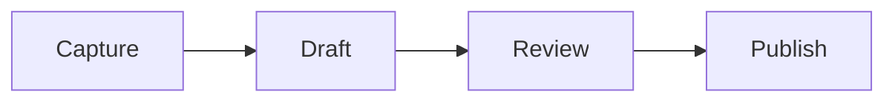

# A quiet notebook

Every word in this note is synthetic. This fixture proves the shared GistPad dialect, without loading the web app.

```toc
```

## A little progress

- [ ] Duplicate task
- [x] Duplicate task
- [X] Completed with an uppercase marker
- [ ] Read **carefully**, then follow [the link](https://gistpad.dev)
  - [ ] A nested task

> - [ ] A quoted task

1. [ ] An ordered task

## Connections

Open [[Ideas]], cite [[0123456789abcdef0123456789abcdef]], mention @octocat and celebrate :tada:.

A numbered bookmark {#} and a named bookmark {#meeting}. A spoiler: >!The notebook works offline.!<

## Useful arithmetic

rate := $5

total: rate * 3 =

_ + 2 =

## A small diagram



## A few richer details

> [!NOTE]
> Native drafts remain the source of truth.

> [!WARNING]
> Secret gist links can be read by anyone who has the link.

> [!TIP]
> Capture a thought before polishing it.

> [!IMPORTANT]
> Saved on this iPhone and saved to GitHub are different states.

> [!CAUTION]
> Review a proposed edit before applying it.

| Feature | Status |
| --- | --- |
| Tables | Ready |
| Strikethrough | ~~Not ready~~ Ready |
| Inline code | `let note = "Hello"` |

<details>
<summary>More to read</summary>

Raw HTML can include <ins>insertions</ins>, <kbd>keys</kbd> and safe disclosure controls.

</details>

A footnote worth following.[^source]

```swift
let message = "Hello, notebook"
```

Emoji and combining marks: 👩🏽‍💻 café é.

日本語のメモ。中文笔记。한국어 메모.

مرحبا بالعالم. שלום עולם.


[^source]: The preview uses the web application's existing plugins.
