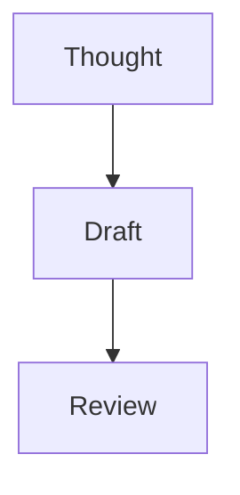
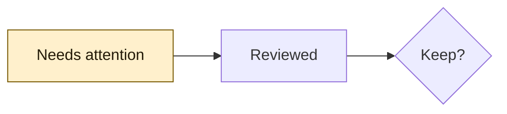

# A considered page

Synthetic reading review. No account content or network is needed.

```toc
```

## Small, useful numbers

rate := $5

total: rate * 3 =

_ + 2 =

## Clear relationships



### An authored distinction

The deliberate styling below must remain distinct from the neutral defaults.



## Room for detail

| Left | Center | Amount |
| :--- | :---: | ---: |
| Notebook | Ready | $15.00 |
| Draft | Local | $17.00 |
| Review | Pending | $32.00 |

| Jan | Feb | Mar | Apr | May | Jun | Jul | Aug | Sep | Oct | Nov | Dec |
| ---: | ---: | ---: | ---: | ---: | ---: | ---: | ---: | ---: | ---: | ---: | ---: |
| 15 | 17 | 32 | 15 | 17 | 32 | 15 | 17 | 32 | 15 | 17 | 32 |
| 17 | 32 | 15 | 17 | 32 | 15 | 17 | 32 | 15 | 17 | 32 | 15 |

<details>
<summary>More to read</summary>

This is a real disclosure. Its text remains selectable, and the keyboard and VoiceOver retain the original expand/collapse semantics.

</details>

<details open>
<summary>Already open</summary>

This authored disclosure starts open and must stay that way.

</details>

## Meaning without color

> [!NOTE]
> A label and symbol identify this information.

> [!TIP]
> Keep the useful thought close.

> [!IMPORTANT]
> Local saving and GitHub publication are different.

> [!WARNING]
> Anyone with a secret gist link can read it.

> [!CAUTION]
> Review changes before applying them.

- [ ] A quiet unfinished task
- [x] A clear completed task
