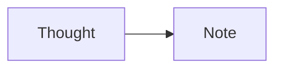

# A rich page

One page, **strong**, _emphasis_, <ins>underlined</ins>, and `inline code`.

## The next steps

- [x] Keep completed work
- [ ] Clean the kitchen
- [ ] Read something unexpected

3. An authored start
4. Another number

| Thought | State |
| :--- | ---: |
| A useful detail | Ready |
| Another idea | Later |

```swift
let thought = "A quiet page"
print(thought)
```




> [!NOTE]
> A GitHub-style note.

[[A linked thought]] and ||a quiet spoiler||.

The bill is $=(2 + 3 * 4).

## 日本語のメモ

今日は良い一日です。
